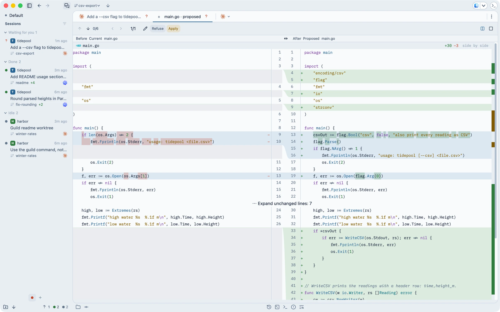
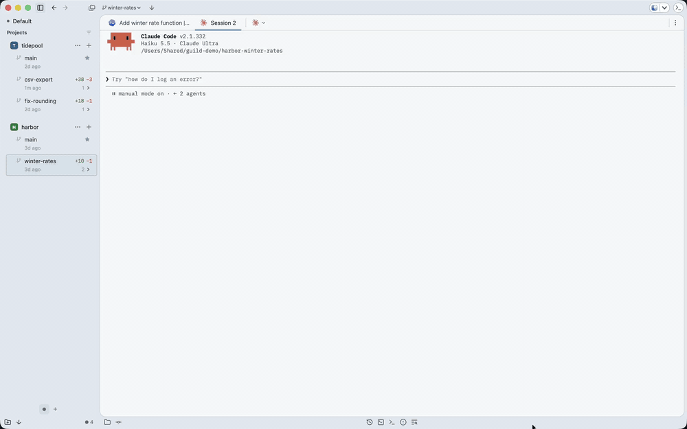
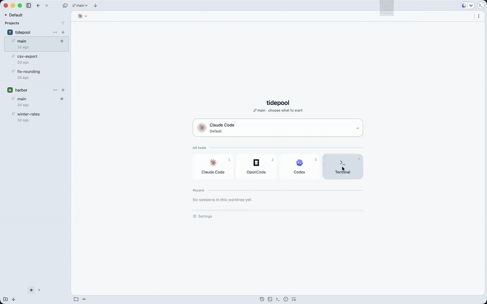
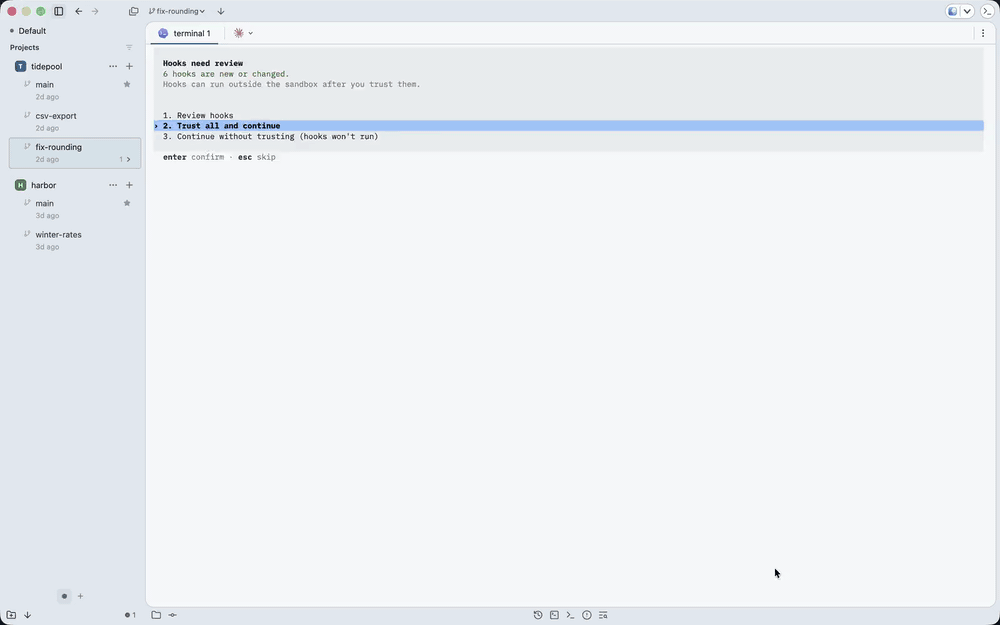
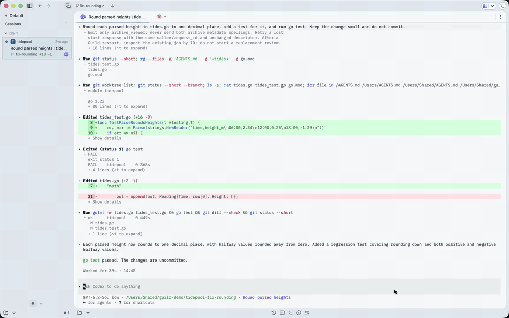
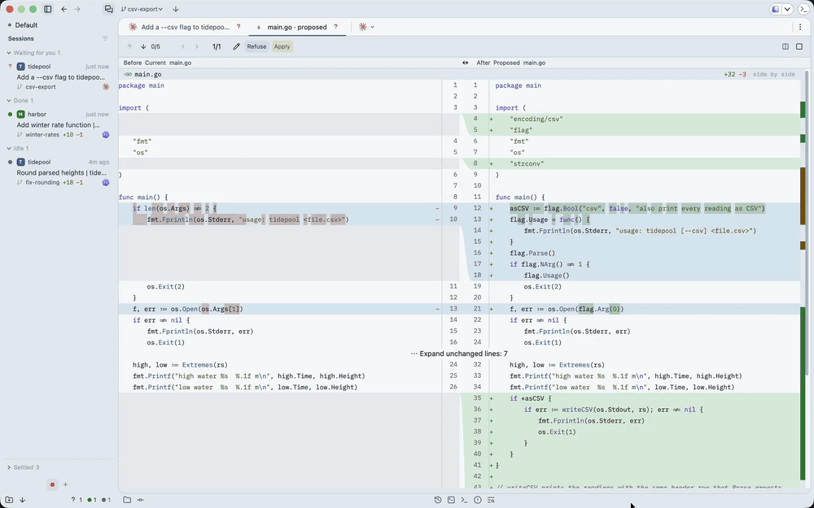
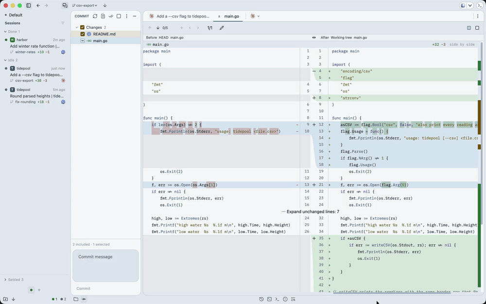
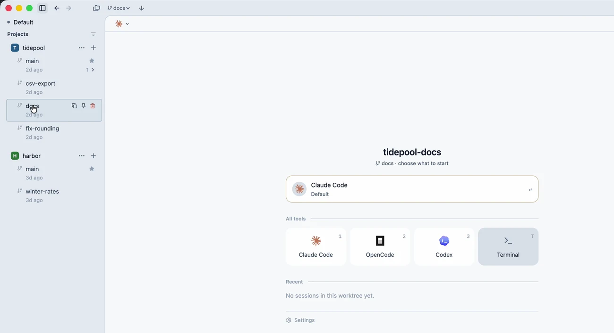
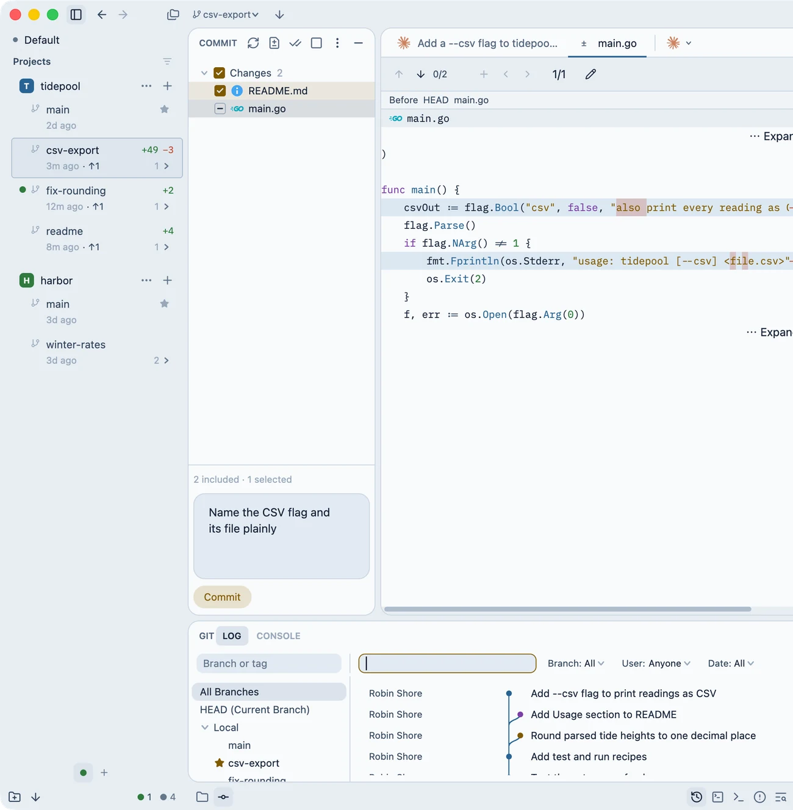

<div align="center">


# Guild

**Run your agents from one window.**<br>
Guild makes worktrees, starts agents and shows who needs you first.

[](#license) [](#requirements) [](rust-toolchain.toml) [](https://crates.io/crates/gpui-kit) [](#requirements)

[Install](#install) · [Features](#features) · [CLI](#drive-it-from-the-command-line) · [Docs](#documentation) · [Changelog](CHANGELOG.md)

</div>

---

<picture>
  <source media="(prefers-color-scheme: dark)" srcset="site/assets/images/sessions-dark.webp">
  
</picture>

## What is Guild

Guild is a native macOS window for running many AI agents at once. It makes git worktrees, starts **Claude Code**, **Codex** and **OpenCode** in them, shows who needs you first, and answers a command line your agents can use too.

It is an ADE — the window a person works in all day while the agents do the work: a file tree, an editor, diffs, git, and agent sessions in tabs. Agents run in the next tab, in the worktree they were given; you read what they did — the files, the diff, the commit — in the same window, and answer them there.

Each agent runs its own CLI, permission prompts and slash commands included, in a terminal of Guild's own. Nothing needs a server or an account: sessions, tabs and settings are files on your Mac. Guild is in daily use, and released as nightlies through its own Update button.

## Demo

<picture>
  <source media="(prefers-color-scheme: dark)" srcset="docs/images/readme/orchestrate-dark.gif">
  
</picture>

<sub>One agent drives the window: Claude Code makes a worktree with `guild worktree create`, starts Codex in it with a task, and waits for the answer with `guild agent wait`.</sub>

## Features

From a worktree to a pushed commit — each step as it looks in Guild.

### Organize — projects, worktrees and workspaces in one column

A project is a repository, and its rows are its worktrees, read from git. Gather projects into groups, and sets of them into named workspaces.

- **Worktrees from anywhere** — one made by hand or by an agent in a terminal is there as surely as one made here.
- **Groups bound to a folder** — a group can sit on the folder that holds its repositories; a session there sees them all.
- **Removed with care** — before a worktree goes, a sheet names what git would delete without a word.

<picture>
  <source media="(prefers-color-scheme: dark)" srcset="docs/images/readme/open-dark.gif">
  
</picture>

### Start — an agent per worktree, in a tab

Start Claude Code, Codex or OpenCode in a worktree, from its `+` or with `guild session new`. Each runs its own CLI in Guild's terminal, the way it runs anywhere else. [More on terminal sessions →](docs/guide.md#terminal-sessions-in-the-desktop)

- **Your launch command** — a prefix and arguments per agent, for a wrapper or a model of your choice.
- **Areas and panes** — split the screen into areas, and a tab into panes, each with its own agent.
- **Pick up where it stopped** — a closed conversation is continued from the start screen or the Sessions list.

<picture>
  <source media="(prefers-color-scheme: dark)" srcset="docs/images/readme/delegate-dark.gif">
  
</picture>

### Follow — see who needs you first

With many agents at once, switch the column to Sessions: those waiting for you come first, then those working, done and idle. A tab waiting for an answer is marked.

- **Reported by the agent** — each CLI says itself whether it is working, asking or finished.
- **Unread until read** — a finished turn stays marked until you have looked at it.
- **Settled** — agents idle for days and closed conversations wait at the bottom, ready to continue.

<picture>
  <source media="(prefers-color-scheme: dark)" srcset="docs/images/readme/follow-dark.gif">
  
</picture>

### Review — read the change before it lands

With `claude --ide`, an edit arrives as a diff tab with Apply and Refuse. Any change opens side by side, and one hunk can be staged on its own. [More on the window →](docs/guide.md#the-window)

- **The agent waits for you** — refuse, and it moves on without writing; apply, and it writes the file in its own turn.
- **Stage a hunk** — the `+` beside a change stages that change alone, and the `−` takes it back out.
- **Who wrote this** — Annotate shows who wrote each run of lines and when; a click opens the commit.

<picture>
  <source media="(prefers-color-scheme: dark)" srcset="docs/images/readme/review-dark.gif">
  
</picture>

### Ship — commit and push from the same window

Tick what goes into the commit and write its message. The Log searches the whole history, and Push Commits shows what is about to leave.

- **Branches and stashes** — switch, create and delete branches, and apply or drop a stash, where git agrees.
- **The default branch kept current** — a clean `main` or `master` is fast-forwarded to its upstream, checked every five minutes.
- **Every write in the Console** — each command the window ran, with git's own words back.

<picture>
  <source media="(prefers-color-scheme: dark)" srcset="docs/images/readme/ship-dark.gif">
  
</picture>

### Also built in

Everything else the window does, by area, and where to find it. Every shortcut can be changed in **Settings ▸ Keymap**.

<details open>
<summary><b>Agents & terminal</b></summary>

| Feature | Where | What it does |
|---|---|---|
| Three agents | `+` beside the tabs | Claude Code, Codex and OpenCode, each its own CLI in a terminal of Guild's own |
| Status from the agent | Tab and column marks | Working, waiting for you, finished, and unread until you have looked |
| Sessions mode | Column ▸ Sessions | Every agent of the workspace, by who needs you first; Settled holds the idle and the closed |
| Diffs from Claude Code | Diff tab | With `claude --ide`, an edit arrives as a diff with Apply and Refuse |
| `guild` for agents | `guild help` | Worktrees, sessions and waiting on another agent, from the agent's own terminal |
| Your launch command | Settings ▸ Tabs & agents | A prefix and arguments per agent, for a wrapper or a model of your choice |
| Links in the terminal | <kbd>⌘</kbd>-click | A file path opens in a tab at its line; a link is followed |
| Find in the terminal | Terminal | Search the history, with copy on select and bracketed paste |
| Continue a conversation | Start screen | What was said in a folder before, ready to resume |

</details>

<details open>
<summary><b>Editor & search</b></summary>

| Feature | Where | What it does |
|---|---|---|
| Search Everywhere | <kbd>⇧</kbd><kbd>⇧</kbd> | Files, symbols and actions in one popup |
| Find in Files | <kbd>⌘⇧F</kbd> | Hits above a preview of the code around them, on ripgrep's own libraries |
| Replace in the project | <kbd>⌘⇧R</kbd> | Across every file of the project, from the same search |
| Go to Symbol and Find Action | <kbd>⌥⌘O</kbd>, <kbd>⇧⌘A</kbd> | Jump to a declaration, or to any command by its name |
| Language servers | <kbd>⌥F7</kbd> | Definitions, usages and problems from the project's servers |
| Thirty-four grammars | File tab | The same colours in a tab, a diff, Annotate and a commit's files |
| Line editing keys | <kbd>⌘D</kbd>, <kbd>⌥⇧↑</kbd>, <kbd>⌘/</kbd> | Duplicate, move lines, comment, and extend the selection with <kbd>⌘↑</kbd> |
| Saved as you type | 300 ms | Written after the last keystroke, never over a change made on disk |
| Explorer | <kbd>⌘B</kbd> | `.gitignore` respected, git's marks on every row, files dragged to and from Finder |

</details>

<details open>
<summary><b>Git</b></summary>

| Feature | Where | What it does |
|---|---|---|
| Commit panel | <kbd>⌘K</kbd> | Tick what goes in, write the message, commit with <kbd>⌘↩</kbd> |
| Stage a hunk | `+` in a diff | One change goes into the index, or back out, on its own |
| Side-by-side diffs | <kbd>⇧⌘D</kbd> | Every changed file, against the last commit, the index or any commit |
| Log | Git ▸ Log | The whole history, filtered by branch, user, date or a hash |
| Annotate | Annotate | Who wrote each run of lines and when; a click opens the commit |
| Push Commits | <kbd>⇧⌘K</kbd> | What is about to leave, file by file, before it does |
| Branches and stashes | Branch in the title bar | Switch, create and delete branches; apply or drop a stash |
| Default branch kept current | Settings ▸ Projects | A clean `main` or `master` is fast-forwarded to its upstream, checked every five minutes |
| Console | Git ▸ Console | Every write the window made, with git's own words back |

</details>

<details open>
<summary><b>Window & settings</b></summary>

| Feature | Where | What it does |
|---|---|---|
| Areas and panes | <kbd>⌃⌘⇧→</kbd>, <kbd>⌃⌘⌥→</kbd> | Split the screen into areas, and a tab into panes |
| Tool windows | <kbd>⌘B</kbd>, <kbd>⌘L</kbd>, <kbd>⌘J</kbd> | Explorer, Commit, Git and the rest in docks you move them between |
| Workspaces and groups | Column | Named sets of projects, and groups bound to the folder that holds them |
| Recent Projects | <kbd>⌥⇧⌘O</kbd> | The whole path matched, so two checkouts of one repository stay apart |
| A keymap of your own | Settings ▸ Keymap | Press the new keys, and they are in force at once |
| Light, dark and your tint | Settings ▸ Appearance | Follow macOS or pick a theme, and tint it with a colour of your own |
| Your plans' limits | Title bar | How much of your Claude Code or Codex plan is left |
| Open In | Title bar | The project in your editor, terminal or Finder |
| Updates | Title bar | A new nightly shows up as Update, with what it brings |

</details>

Every panel, menu and shortcut is described in [the guide](docs/guide.md#the-window).

## Drive it from the command line

Projects, workspaces, worktrees and sessions come from `guild` as well as from the window, typed by you or by an agent in one of its tabs. Every session Guild starts has `guild` on its `PATH`; an agent that was itself given a task cannot start another one.

| Command | What it does |
|---|---|
| `guild workspace create NAME` | A named set of projects; `guild workspace select` switches to it |
| `guild worktree open PATH` | A repository joins the column, with every worktree git lists for it |
| `guild worktree create NAME --prompt TEXT` | A new worktree, and an agent started in it with the task |
| `guild session new --group NAME` | A session over a group's folder, where its projects sit side by side |
| `guild agent list` | Every session, and what its agent is doing |
| `guild agent wait SESSION` | Waits for the agent's turn to end; `guild agent read` returns what it said |

`guild help` lists the rest. The command is a door to the open window, never a second way to do a thing: it calls the same deed a person's gesture calls, so the same guards hold for an agent.

## Local, and yours

A window on your Mac around the agent CLIs you already use. Nothing in it needs a server.

- **No server, no account.** Sessions, tabs and settings are files in `~/.config/guild`.
- **Your settings left alone.** Guild hands its hooks only to the sessions it starts, through a settings file of its own. Your `~/.claude/settings.json` is never edited.
- **Twenty-one named git writes, and nothing else.** `--force`, `--hard`, `-D` and `stash pop` are spelled nowhere in Guild, and a test greps every write for them; a rollback asks first. See [decision 21](docs/decisions.md).
- **Native, in Rust.** One Rust workspace on GPUI. The terminal is Guild's own, on `alacritty_terminal`.

<picture>
  <source media="(prefers-color-scheme: dark)" srcset="site/assets/images/tile-start-dark.webp">
  
</picture>

## Install

### Requirements

- macOS 13 or later, on Apple silicon.
- At least one agent CLI. Guild reads each agent's status from its CLI, which needs **Claude Code 2.1.295**, **Codex 0.163.0** or **OpenCode 2.2** or later.

### Download

1. Download Guild from the [releases](https://github.com/proshik/guild/releases) and move it to Applications.
2. Choose **File ▸ Open…** and pick a repository.
3. Press **+** beside the tabs and choose an agent.

Guild is not notarized yet: the first time, Control-click it in Applications and choose **Open**.

Guild is released as nightlies from `main`, published on the Releases page. Once installed, it updates itself: when a new nightly is ready, **Update** appears in the title bar, with what it brings. If no build is listed there yet, build it from source.

### Build from source

You need the Rust toolchain from [rustup](https://rustup.rs) (not Homebrew's `rust`), [`just`](https://github.com/casey/just), and the Xcode Command Line Tools.

```bash
git clone https://github.com/proshik/guild.git
cd guild
just toolchain   # must print "overridden by '<repository>/rust-toolchain.toml'"
just desktop     # run a development build
just app         # assemble Guild.app and open it
just install     # a dev build swapped into /Applications (quit Guild first)
```

The toolchain comes from `rust-toolchain.toml`; the workspace needs Rust 1.88 or later. Homebrew's `cargo` ignores that file, which is why `just toolchain` checks it. `just install` refuses a tree with uncommitted changes and refuses while the installed Guild runs — see [Developing Guild in Guild](docs/desktop-dev.md).

<picture>
  <source media="(prefers-color-scheme: dark)" srcset="site/assets/images/close-dark.webp">
  
</picture>

## Configuration

Everything Guild keeps is local, in `~/.config/guild` (or `$XDG_CONFIG_HOME/guild`):

| File | What it holds |
|---|---|
| `settings.json` | Settings; most are changed in the Settings tab |
| `workspace.json` | Projects, workspaces and sessions |
| `keymap.json` | Only the shortcuts you have changed, so a changed default still reaches you |

A file in a previous format is read and migrated; a corrupted one leaves the defaults in force rather than stopping the window from opening.

**Settings ▸ Tabs & agents** gives each agent its own launch command: a **Prefix** before the program and **Arguments** after it. Prefix `pai` with arguments `--model glm` launches `pai codex --model glm …`, so a wrapper or a model of your choice works without touching Guild. The detail — quoting, login shells, permissions per agent — is in [the guide](docs/guide.md#running-it).

## Project layout

A Cargo workspace of three crates, with boundaries the compiler does not check and `just boundaries` does:

```
crates/
  session/   what can be checked without a window: sessions, transcripts, harnesses,
             settings, the workspace, the command vocabulary. No GPUI
  desktop/   the GPUI window: title bar, the column, tabs, our own terminal, the editor
  cli/       `guild`, the command line the open window answers, and `guild-release`. No GPUI
```

[`AGENTS.md`](AGENTS.md) maps the desktop crate module by module; [the guide](docs/guide.md#layout) says why the boundaries are where they are.

## Documentation

- [Guide: the window in detail](docs/guide.md) — every panel and menu, terminal sessions, the stack, and running Guild
- [Project rules](AGENTS.md) — how work is done, the desktop crate's module map, and the boundaries that are easy to break unnoticed
- [Decisions](docs/decisions.md) — the rules in force, under the numbers code cites
- [Design system](docs/design-system.md) — tokens, component anatomy and measures; the theme's tests read it
- [Traps](docs/traps.md) — bugs and hours this repository has already paid for, by area
- [Runtime ownership](docs/runtime-ownership.md) — who owns the processes the window starts
- [Search](docs/search.md), [Sessions](docs/sessions.md), [Overlays](docs/overlays.md) — how those behave
- [Development workflows](docs/workflows/README.md) — the configured process definitions
- [Developing Guild in Guild](docs/desktop-dev.md) — releases, dev builds and the dev window beside the installed one
- [GPUI Kit](docs/gpui-kit-migration.md) — what to know before raising the GPUI and component versions
- [Update sources](docs/updates/owner-guide.md) — the owner's runbook for distribution
- [OpenSpec](openspec/README.md) — how a change's behaviour is agreed before it is built; `openspec/specs/` is the baseline
- [Changelog](CHANGELOG.md) — what changed, nightly by nightly

The window is designed in Penpot before it is coded — [docs/penpot.md](docs/penpot.md) says where and how.

## Contributing

- Read [`AGENTS.md`](AGENTS.md) first, and [`docs/traps.md`](docs/traps.md) before working in an area a trap names.
- Run `just check` before each commit: formatting, clippy with no warnings, crate boundaries, tests — in that order. `just --list` shows the rest.
- A change a person would see in the window is designed in Penpot first ([docs/penpot.md](docs/penpot.md)).
- A change a person would notice adds its line to [`CHANGELOG.md`](CHANGELOG.md) under `## [Unreleased]`, in its own branch.

## License

Guild is licensed under either of

- Apache License, Version 2.0 ([LICENSE-APACHE](LICENSE-APACHE))
- MIT license ([LICENSE-MIT](LICENSE-MIT))

at your option. Vendored assets — fonts, icons, grammars and their queries — keep their own licences, which sit beside them with a `PROVENANCE` where one is needed.
